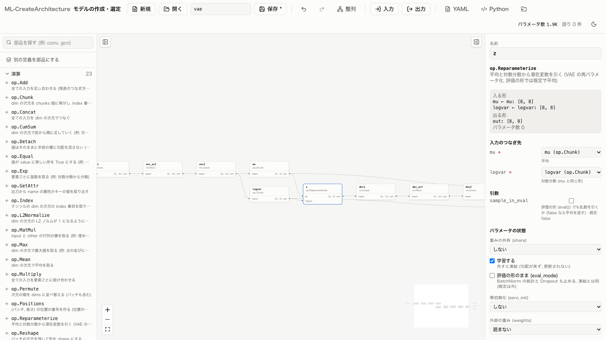
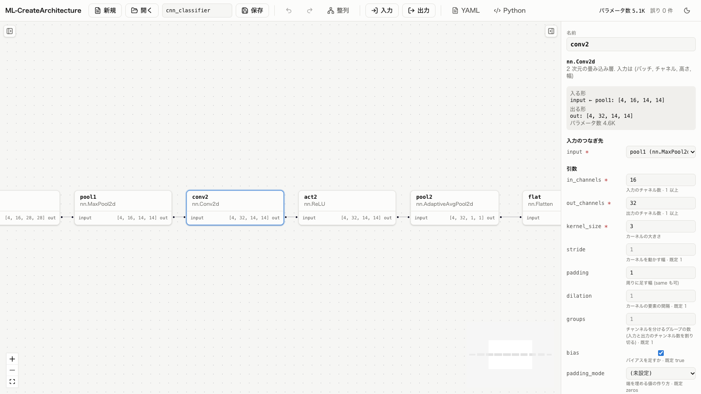
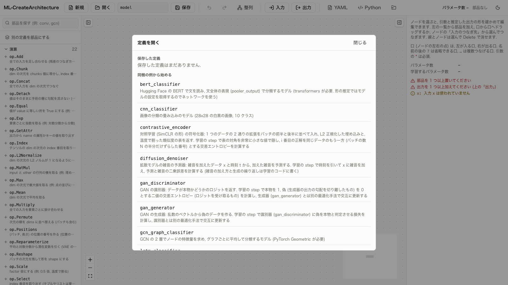
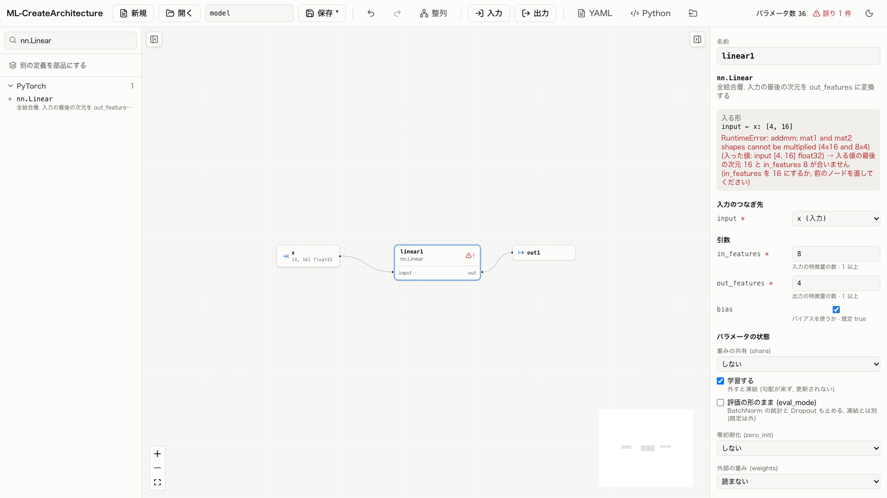
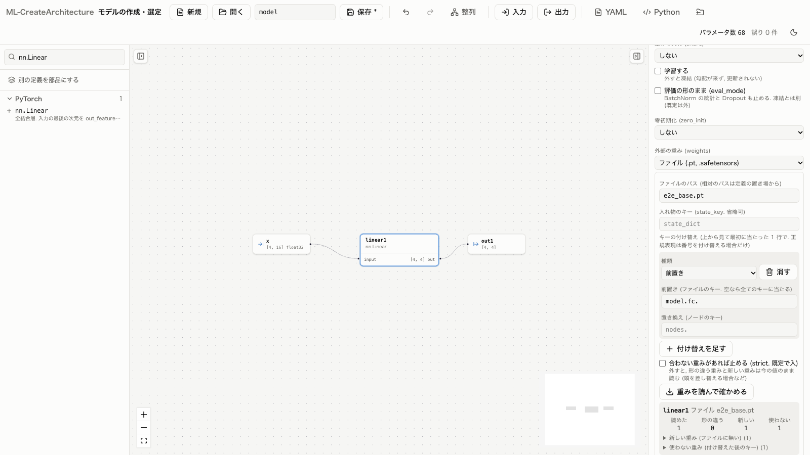
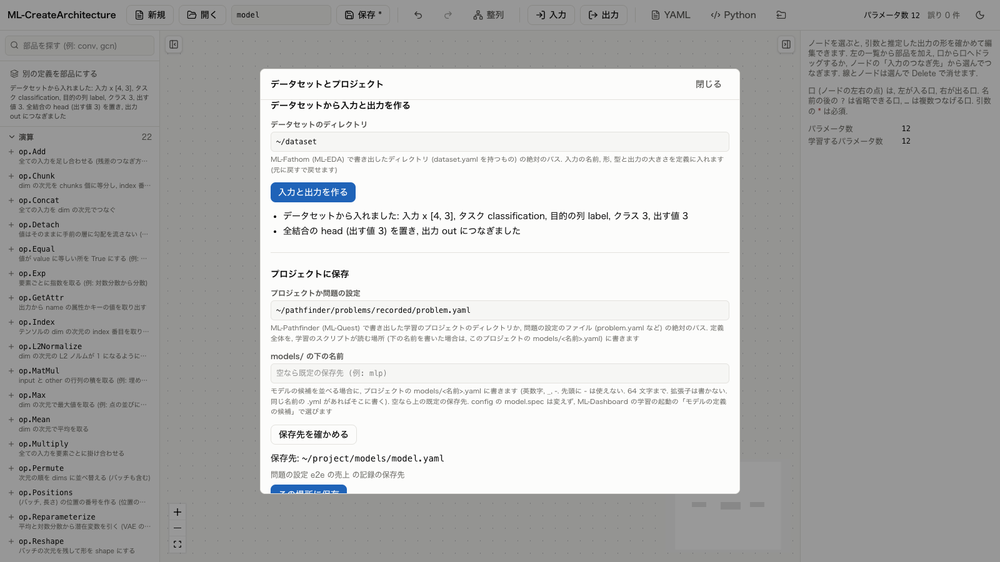
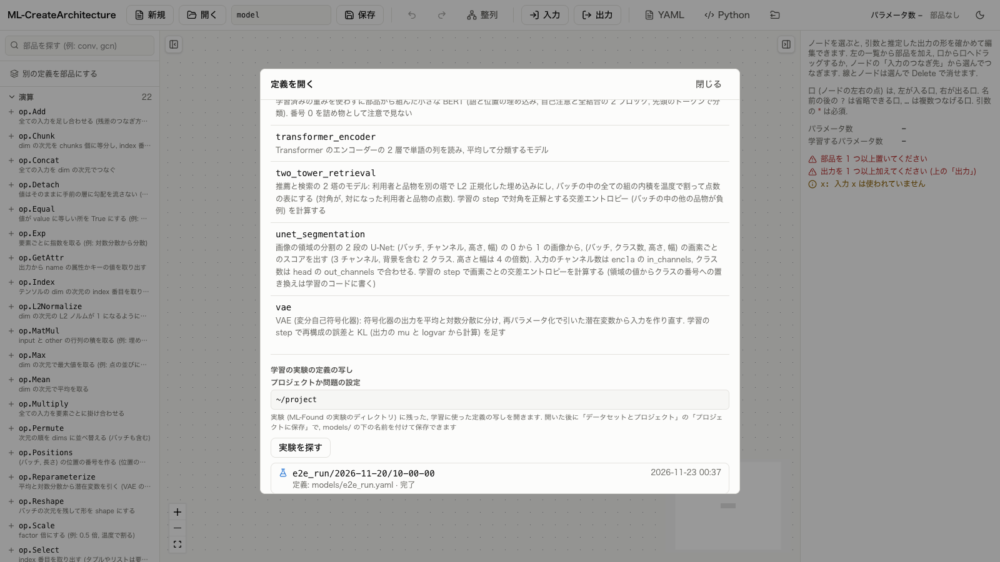

# ML-CreateArchitecture

[ML-ModelControl](https://github.com/victor-von-pooh/ML-ModelControl) の部品を GUI で並べてつなぎ, PyTorch のモデルを組み立てるローカルの Web アプリ.

「機械学習を全て GUI 上で行う」うちの「モデルの作成・選定」の段階の画面. 作った定義 (YAML) は ML-ModelControl でそのまま `nn.Module` になり, ML-Found で学習できる.



<table>
  <tr>
    <td></td>
    <td></td>
  </tr>
  <tr>
    <td>CNN の例. ノードごとに推定した出力の形が出て, 右の詳細で引数を説明と範囲付きのフォームで決める</td>
    <td>「開く」の一覧. 保存した定義と, 同梱の例 (CNN, LSTM, Transformer, GCN, BERT など) と受け持ちごとの雛形 (VAE, GAN, 拡散, 対照, 2 塔, 方策と価値, 異常の検知, 効果を見積もる, 値段を変える判断, 時間をまたぐ量の判断)</td>
  </tr>
  <tr>
    <td></td>
    <td></td>
  </tr>
  <tr>
    <td>形の誤り. 入ってきた値の形と, どの引数をどう直すかが出る</td>
    <td>パラメータの状態. 凍結, 零初期化, 外部の重み (キーの付け替え付き) を書き, 「重みを読んで確かめる」で読めた / 形の違う / 新しい / 使わない重みの数を見る</td>
  </tr>
  <tr>
    <td></td>
    <td></td>
  </tr>
  <tr>
    <td>データセットとプロジェクト. ML-Pathfinder の問題の設定を選ぶと, ML-Fathom で書き出したデータセットから入力と出力を作り, 学習のプロジェクトの保存先が入る</td>
    <td>学習の実験の定義の写し. プロジェクトの実験 (ML-Found) を探し, 学習に使った定義を開いて手直しの元にする</td>
  </tr>
</table>

画面の例は ML-ModelControl に同梱の例 (`vae`, `cnn_classifier`) と, 全結合の層 1 つを置いた定義 (外部の重みは小さな見本のファイル), 画面の通しのテストの見本 (3 クラスの分類のデータセット, 学習のプロジェクト, 問題の設定, 実験). 外部のライブラリを入れずに (`make setup` のまま) 起動した. 作業用の置き場の場所は `~` で示す.

## できること

- **組み立て**: 部品 (`nn.Linear` のような層, 足し算や連結のような演算, PyTorch Geometric, Hugging Face, torchvision, timm などのモデル) を一覧から選んで置き, 線でつなぎ, 引数をフォームで決める
- **確かめる**: 編集するたびに定義を確かめ, ノードごとの出力の形とパラメータ数を推定する. 誤りは理由と直し方付きで出る
- **例と雛形**: 同梱の例と受け持ちごとの雛形から始める
- **部分モデル**: 保存した定義や例を 1 つの部品 (`sub.<名前>`) として重ね, 中身を編集する
- **パラメータの状態**: 凍結, 評価の形のまま, 零初期化, 重みの共有, 外部の重みの読み込み (ML-ModelControl の定義の版 2)
- **引数に書く部品**: 別の部品を引数に取るクラス (`nn.TransformerEncoder` の `encoder_layer` など) に, 部品を選んでその引数を入れ子で書く (ML-ModelControl の定義の版 3)
- **学習済みの重みのライセンス**: 重みを読む部品のノードで, ライセンスと商用で使えるか, 表示の義務, 出どころの表記, 重みの大きさを確かめる. 申請制の重みを読めなかった場合は, 理由と次にすることが日本語で出る
- **自作の部品**: 研究で書いた `nn.Module` を, 起動の設定に書いたモジュールから部品の一覧に加える
- **データセットとプロジェクト**: ML-Fathom (ML-EDA) で書き出したデータセットから入力の名前と形, 出力の大きさを入れ, ML-Pathfinder (ML-Quest) で書き出した学習のプロジェクトの, 学習のスクリプトが読む場所か, `models/` の下の名前 (ML-Dashboard で比べるモデルの候補) に定義を保存する. ML-Pathfinder に保存した問題の設定を一覧から選ぶと, 両方の場所が入り, 受け持ちに合う雛形があれば新しく始める場合はそれを開く. 表の生成の問題の設定では, 入力と出力の幅を学習のスクリプトと同じ符号化した行の幅 (ML-Quest の `table_encoding`) にし, どう決めたかを出す. 並べるの問題の設定では, 反応の表から入力 `user` と `item` の大きさを学習のスクリプトと同じ学習用の利用者と品物の数 (ML-Quest の `rank_encoding`) にし, どう決めたかを出す. 異常の検知のデータセットでは, 自己符号化器の入力と出力の幅を学習に使う列の数にし, どう決めたかを出す. 効果を見積もるのデータセットでは, 入力の幅を処置の列を除いた学習に使う列の数にし, 処置したときとしないときの 2 つの出力をどちらも 1 にして, どう決めたかを出す. 値段を変える判断のデータセットでは, 入力の幅を商品の特徴の列と値段の列の数 (売れた数, 原価, 商品の id と行の id の列は数えない) にし, 売れた数の予測の出力を 1 にして, どう決めたかを出す. 需要の記録のデータセットでは, 入力の幅を学習に使う列の数 (日ごとの売れた数, 商品の id, 日付, 在庫の数と行の id の列は数えない) にし, 分位点の出力の値の数を学ぶ水準の数 (プロジェクトの学習の設定か, 無ければ問題の設定の水準) にして, どう決めたかを出す
- **実験の定義の写し**: 学習のプロジェクトの実験 (ML-Found) に残った, 学習に使った定義の写しを「開く」から開き, 手直しして `models/` の下に名前を付けて保存する
- **書き出し**: 定義の YAML と, 同じ計算をする Python のコード (ML-ModelControl を入れていない環境でも動く) をコピーかダウンロード
- 元に戻す・やり直す, 整列, 下書き, キーボードの操作, ライトとダークの表示

## 使い方

### 必要なもの

- [uv](https://docs.astral.sh/uv/) (Python は uv が用意する. 3.10 以上). ML-ModelControl の依存の PyTorch も入るので, 最初の `make setup` は時間がかかる
- Node.js 24 以上と [pnpm](https://pnpm.io/) 11 以上 (`corepack enable` で `package.json` の版が入る)

### 導入と起動

```bash
git clone --recursive https://github.com/victor-von-pooh/ML-CreateArchitecture.git
cd ML-CreateArchitecture
make setup   # submodule, Python と Node.js の依存 (データセットとプロジェクトにつなぐ ML-EDA と ML-Quest も)
make serve   # 画面をビルドして http://127.0.0.1:8766 で起動 (使う間は端末を開いたままにする. Ctrl+C で止める)
```

起動すると, 画面のビルドのログの後に `ML-CreateArchitecture を開く: http://127.0.0.1:8766/api/auth?token=...` の行が出るので, その URL をブラウザで開く (トークンは起動ごとに変わる). 毎回同じトークンにする場合は, 環境変数 `ML_CREATEARCHITECTURE_TOKEN` で指定する. ポートは `make serve PORT=8800` のように変えられる.

外部のライブラリの部品を使う場合は, `make setup` に `EXTRAS` を付けてバックエンドに入れる (入れていないライブラリの部品は, 一覧に「使えない」と理由が出る). 全て入れると数 GB になり時間がかかる. `EXTRAS` を付けると既定の `project` が置き換わるので, 一緒に書く. `EXTRAS` から外したライブラリは, `make setup` をやり直すと外れる.

```bash
make setup EXTRAS="project all"                       # 全て
make setup EXTRAS="project torchvision timm"          # 一部だけ
```

`EXTRAS` に書ける名前は `project` (ML-EDA と ML-Quest. 既定), `geometric` (PyTorch Geometric), `huggingface`, `torchvision`, `timm`, `torchaudio`, `einops`, `kornia`, `monai`, `smp` (segmentation_models_pytorch), `all` (外部のライブラリの全て).

新規の画面には入力 `x` (形 `[4, 16]`) がある. `x` を選び, `/` を押して `nn.Linear` と打って Enter を押すと, `x` につながった `linear1` が置かれる. 右の詳細で `in_features` を `16`, `out_features` を `4` にし, 上の「出力」を押すと「パラメータ数 68」「誤り 0 件」になる. 名前を書いて「保存」(Ctrl+S) で保存する.

保存した定義は `~/.ml-createarchitecture/models/<名前>.yaml` に置かれる (環境変数 `ML_CREATEARCHITECTURE_HOME` で変えられる). [ML-ModelControl](https://github.com/victor-von-pooh/ML-ModelControl) の `build_model` で `nn.Module` にできる.

```python
from pathlib import Path
from ml_modelcontrol import build_model

model = build_model(Path("~/.ml-createarchitecture/models/first_mlp.yaml").expanduser())
```

ML-Pathfinder で書き出した学習のプロジェクトには, 上の「データセットとプロジェクト」で, データセットから入力と出力を作り, プロジェクトに保存できる (操作ガイドの 9 章). ML-Found で学習する手順は, [ML-ModelControl](https://github.com/victor-von-pooh/ML-ModelControl) の README を参照.

## 文書

- [操作ガイド](docs/GUIDE.md): 画面の順の操作ガイド (分岐と合流, 誤りの直し方, 部分モデル, 下書き, データセットとプロジェクト, 自作の部品, 操作の一覧). 最後の章が「困ったとき」
- [設計](docs/DESIGN.md): 今の設計と決まり (ML-ModelControl, ML-EDA, ML-Quest との約束, 画面, API, 用語, 置き場, 安全)
- [TODO](TODO.md): まだやっていないこと (優先度の順)

## 開発

```bash
make dev-backend    # API (変更を自動で読み直す. 開く URL を出す)
make dev-frontend   # 画面 (別の端末で. make dev-backend が出す http://localhost:5173/api/auth?token=... を開く)
make check          # lint, 型検査, テスト
make api            # API を変えたら, 画面の型を作り直す
cd frontend && pnpm exec playwright install chromium   # 通しのテストのブラウザ (最初の 1 回)
cd frontend && pnpm e2e   # 画面の通しのテスト (アプリを起動してブラウザで操作する)
```

README の画面の例 (`docs/images/*.png`) は, `cd frontend && pnpm build && bash e2e/serve.sh` で通しのテストの見本を置いて起動し, 別の端末で `cd frontend && node e2e/screenshots.ts` を実行して撮り直す (Chrome を使う).

| ディレクトリ | 内容 |
| --- | --- |
| `backend/` | API (Python, FastAPI). ML-ModelControl の確認, 形の推定, 書き出しを呼び, 定義のファイルを保存する |
| `frontend/` | 画面 (TypeScript, React, Vite, React Flow) |
| `ML-ModelControl/` | submodule (モデルの定義のライブラリ) |
| `docs/` | 操作ガイド, 設計, README と操作ガイドの画面の例 (`images/`) |

## ライセンス

MIT
