# ML-CreateArchitecture 操作ガイド

ML-CreateArchitecture の使い方を, 実際にモデルを作る順に説明する. 各章の「やってみる」は, 前の章で作ったものを使いながら, アプリだけで試せる (外部のライブラリやネットワークは要らない).

## 目次

0. [準備](#準備)
1. [起動する](#1-起動する)
2. [画面の見方](#2-画面の見方)
3. [最初のモデルを作る](#3-最初のモデルを作る)
4. [分岐と合流のあるモデルを作る](#4-分岐と合流のあるモデルを作る)
5. [誤りを見つけて直す](#5-誤りを見つけて直す)
6. [例を開き, YAML と Python のコードを見る](#6-例を開き-yaml-と-python-のコードを見る)
7. [部分モデル (別の定義を部品にする)](#7-部分モデル-別の定義を部品にする)
8. [保存と下書き](#8-保存と下書き)
9. [作った定義を使う](#9-作った定義を使う)
10. [自作の部品を使う](#10-自作の部品を使う)
11. [操作の一覧](#11-操作の一覧)
12. [困ったとき](#12-困ったとき)

画面の図は, 幅 1600 px のブラウザで, 外部のライブラリを入れずに (`make setup` のまま) 起動したもの. 幅の狭い画面では, 上の操作の一部がアイコンだけになる (2 章の表). 左の一覧の部品の数は, 入れた外部のライブラリ (README の `EXTRAS`) で変わる.

## 準備

この手順書でよく使う言葉.

| 言葉 | 意味 |
| --- | --- |
| 部品 | モデルの 1 つの単位. `nn.Linear` のような層, `op.Add` のような演算, 外部のライブラリのモデルなど. 左の一覧に並ぶ |
| ノード | キャンバスに置いた部品の 1 つ. 名前 (`linear1` など) と, 引数の値と, 入力のつなぎ先を持つ |
| 口 | ノードの左右の点. 左が入る口, 右が出る口. 線は出る口から入る口へ引く |
| 定義 | モデルの入力, ノード, 出力をまとめたもの. YAML のファイルとして保存し, ML-ModelControl で `nn.Module` にできる |
| 部分モデル | 別の定義を, この定義の中で 1 つの部品 (`sub.<名前>`) として使うもの |
| 形の推定 | 入力の形から, 各ノードの出力の形とパラメータ数を計算すること. ノードに `[4, 16]` のように出る |

「やってみる」の前に, ML-CreateArchitecture を README の「導入と起動」の手順で導入しておく (`make setup`. PyTorch も入るので, 最初は時間がかかる).

## 1. 起動する

ML-CreateArchitecture はローカルで動く Web アプリ. 端末で起動して, 表示された URL をブラウザで開く.

1. ML-CreateArchitecture を clone したディレクトリで `make serve` を実行する. 画面をビルドしてから `http://127.0.0.1:8766` で待ち受ける. 端末は使ったままになるので, 止めるまでそのままにする
2. 端末に `ML-CreateArchitecture を開く: http://127.0.0.1:8766/api/auth?token=…` と出るので, その URL を開く. トークンは起動するたびに変わる
3. 真ん中に入力 `x` が 1 つだけ置かれた画面が開けば準備完了

```bash
make serve
```

> **トークンを毎回同じにする**
> `ML_CREATEARCHITECTURE_TOKEN=好きな文字列 make serve` で起動すると, `http://127.0.0.1:8766/api/auth?token=好きな文字列` を開けば入れる.

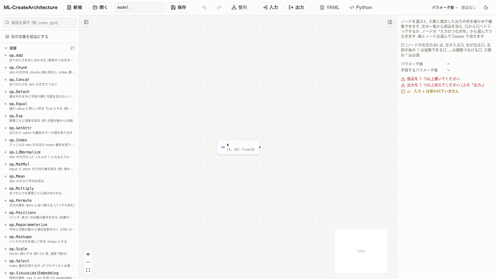

## 2. 画面の見方

| 場所 | 中身 |
| --- | --- |
| 左 | 部品の一覧. 出どころ (演算, PyTorch, PyTorch Geometric, Hugging Face, torchvision など) ごとに畳んである. 上の欄で名前と説明から探せる (`conv`, `gcn`, `residual` のような呼び方でも見つかる). 入れていないライブラリの部品は, 理由と入れ方が出て選べない |
| 真ん中 | キャンバス. 入力, ノード, 出力を置き, 線でつなぐ. ノードには推定した出力の形が出る. ホイールで拡大と縮小, 空いた所をドラッグで移動. 左下のボタンで全体が見える大きさに合わせる |
| 右 | 選んだものの詳細. ノードを選ぶと, 名前, 入る形と出る形, パラメータ数, 誤り, 入力のつなぎ先 (口に説明があれば欄の下に出る), 引数のフォームが出る. 何も選んでいないと, 全体のパラメータ数と誤りの一覧が出る |
| 上 | 新規, 開く, 保存する名前と保存, 元に戻す・やり直す, 整列, 入力と出力を加える, YAML と Python のコードを見る, 明るさの切り替え. 右に全体のパラメータ数と誤りの数 (部品を置くまでは「部品なし」) |

幅の狭い画面 (1536 px 未満) では, 上の操作の一部がアイコンだけになる. マウスを重ねると名前が出る.

| アイコン | 操作 |
| --- | --- |
| 左右の曲がった矢印 | 元に戻す, やり直す |
| 枝分かれした四角 | 整列 |
| 四角へ入る矢印 (→\|) | 入力を加える |
| 四角から出る矢印 (\|→) | 出力を加える |
| 紙 | YAML |
| `</>` | Python |
| 月 (暗い表示では太陽) | 明るさの切り替え |

左右の欄は, キャンバスの左上と右上のボタンで畳める (幅 1200 px 未満の画面では畳んで始まる).

## 3. 最初のモデルを作る

全結合の層 1 つのモデル (16 次元を 4 次元にする) を作って保存する.

新規の画面には, 入力 `x` (形 `[4, 16]`. バッチの大きさ 4, 特徴量 16) が最初からある. 形は形の推定にだけ使い, 作ったモデルの入力の大きさを決めるものではない.

### やってみる 1: 全結合の層を置いてつなぐ (3 分)

- [ ] キャンバスの入力 `x` を押して選ぶ
- [ ] `/` を押して左の検索欄に移り, `nn.Linear` と打って Enter を押す. `x` の右に `linear1` が置かれ, `x` から `linear1` の口 `input` へ線が引かれる. 右の詳細の引数の最初の欄 (`in_features`) に移る
- [ ] `in_features` に `16` を入れて Enter. 次に `out_features` の欄を押して `4` を入れて Enter (Enter は値を確定するだけで, 次の欄には移らない. Tab で次の欄に移ってもよい. `*` は必須の引数. 欄の下に説明と範囲が出る. 範囲の外の値や文字を入れると, その場で理由が出る)
- [ ] 上の「出力」(アイコンだけの場合は, 四角から出る矢印) を押す. つながっていないノードが `linear1` だけなので, 出力 `out1` が `linear1` につながる. 押し忘れると「出力を 1 つ以上加えてください」の誤りが残る
- [ ] 全体が見えない場合は, キャンバスの左下の四角いボタン (全体を合わせる) を押す
- [ ] 上の右が「パラメータ数 68」「誤り 0 件」になり, `linear1` と `out1` に形 `[4, 4]` が出ることを見る
- [ ] 上の名前の欄を `first_mlp` にして, 「保存」を押す (Ctrl+S でもよい). 右下に「first_mlp に保存しました」と出る

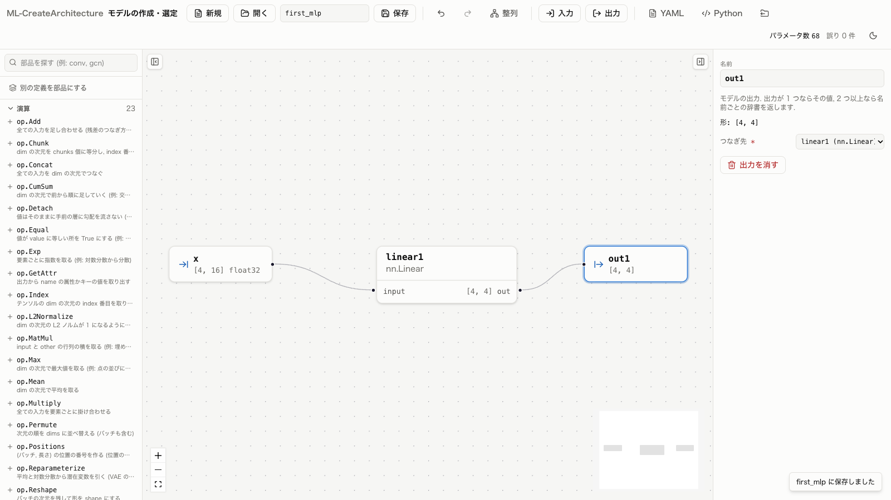

**見どころ**: パラメータ数 68 は, 重み 16 × 4 = 64 とバイアス 4 の合計. 何かを変えると数秒で確認と形の推定がやり直され, 上の数と各ノードの形が更新される. 保存していない変更がある間は, 「保存」のボタンに `*` が付く.

> **線を手で引く場合**
> 何も選ばずに部品を置いた場合や, 一覧からキャンバスにドラッグして置いた場合は, 線は引かれない. 出る口 (ノードの右の点) から入る口 (左の点) へドラッグするか, 右の詳細の「入力のつなぎ先」で選ぶ.

## 4. 分岐と合流のあるモデルを作る

入力を 2 つに分けて, 片方だけを変換してから足し合わせる「残差のつなぎ方」のモデルを作る. 1 つの出力を 2 か所に送ること (分岐) と, 2 つの値を 1 つの口に集めること (合流) を試す.

```
x ─┬─ linear1 ─ relu1 ─┐
   └───────────────────┴─ add1 ─ linear2 ─ 出力
```

### やってみる 2: 残差のつなぎ方 (5 分)

- [ ] 上の「新規」を押す (`first_mlp` は保存したので確かめずに新しくなる)
- [ ] `x` を選び, `/` → `nn.Linear` → Enter で `linear1` を置き, `in_features` と `out_features` を両方 `16` にする
- [ ] キャンバスの `linear1` を押して選び, `/` → `nn.ReLU` → Enter で `relu1` を置く (`linear1` からつながる)
- [ ] `relu1` を選び, `/` → `op.Add` → Enter で `add1` を置く. `add1` の口 `xs` の後の `…` は, 複数つなげる口の印
- [ ] 右の詳細の「入力のつなぎ先」の `xs` に `1. relu1` がある. その下の「(つなぎ先を加える)」の欄で `x (入力)` を選ぶ. `2. x` が加わり, `x` から `add1` へ 2 本目の線が引かれる (`x` の右の点から `add1` の `xs` へドラッグしてもよい)
- [ ] `add1` を選び, `/` → `nn.Linear` → Enter で `linear2` を置き, `in_features` を `16`, `out_features` を `3` にする
- [ ] 上の「出力」を押し, 上の「整列」を押す (つながりの順に左から右へ並ぶ)
- [ ] 「パラメータ数 323」「誤り 0 件」になることを見て, `my_residual` という名前で保存する

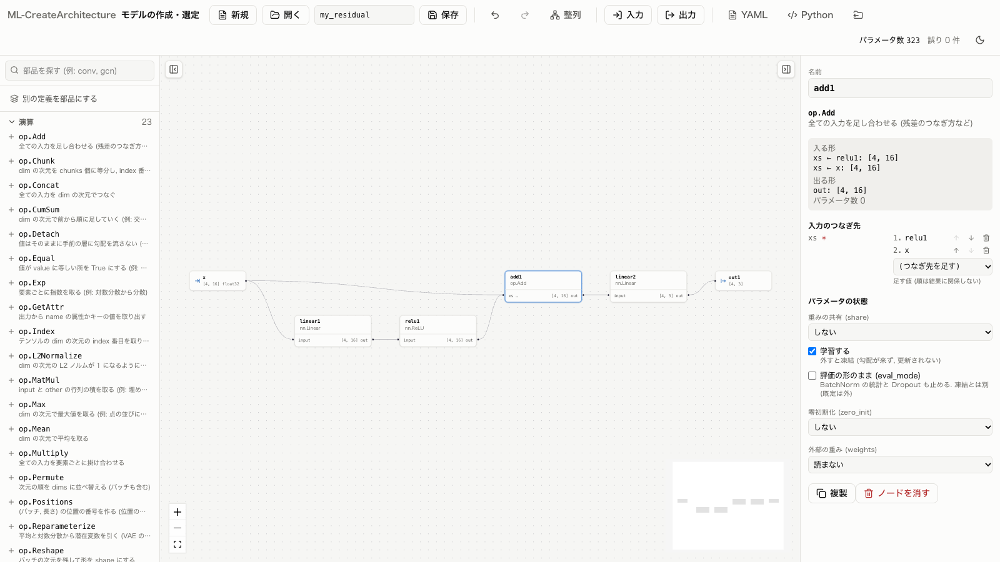

**見どころ**: `add1` の詳細の「入る形」に, `xs ← relu1: [4, 16]` と `xs ← x: [4, 16]` の 2 つが並ぶ. 足し算は同じ形どうしでないとできないので, `linear1` の `out_features` を 16 以外にすると, `add1` で誤りになる. つなぎ先の横の矢印で順番を入れ替え, ごみ箱で外せる.

> **つなぎ先が 1 つだけの足し算**
> `op.Add` のように複数の入力をまとめる演算に 1 つしかつないでいないと, 「つなぎ先が 1 つだけです」という注意が出る (誤りではないが, つなぎ忘れの目印になる).

## 5. 誤りを見つけて直す

誤りには, 確認で分かるもの (必須の引数が無い, 必須の口がつながっていない, 範囲の外の値など) と, 形の推定で分かるもの (前のノードから入る形と引数が合わないなど) がある. どちらも上の「誤り n 件」に数えられ, ノードに赤い印が付く.

### やってみる 3: 形の誤りを直す (3 分)

- [ ] `my_residual` の `linear2` を選び, `in_features` を `15` にする
- [ ] 上が「誤り 1 件」になり, `linear2` に赤い印が付くことを見る
- [ ] 右の詳細の赤い文を読む. 前半は PyTorch のエラー (`RuntimeError: addmm: …`) と入ってきた値の形で, `→` の後に「入る値の最後の次元 16 と in_features 15 が合いません (in_features を 16 にするか, 前のノードを直してください)」という理由と直し方が出る
- [ ] キャンバスの空いた所を押して選ぶのをやめ, 右の「形の推定で失敗したもの」に `linear2` が出ることを見る (押すとそのノードを選ぶ)
- [ ] Ctrl+Z (Mac は Cmd+Z) で元に戻し, 「誤り 0 件」に戻ることを見る. 保存した時点と同じに戻るので, 「保存」の `*` も消える

<table>
  <tr>
    <td>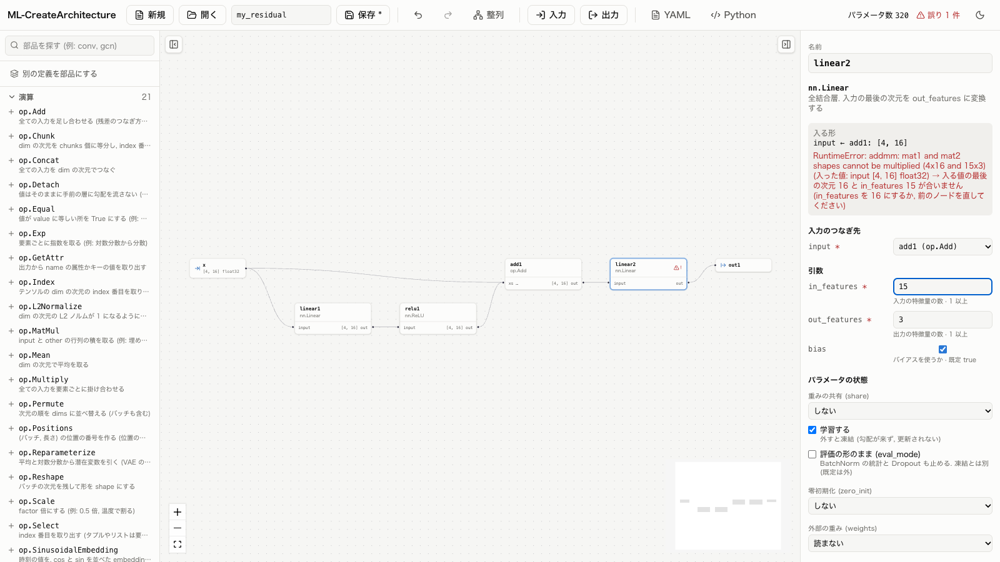</td>
    <td>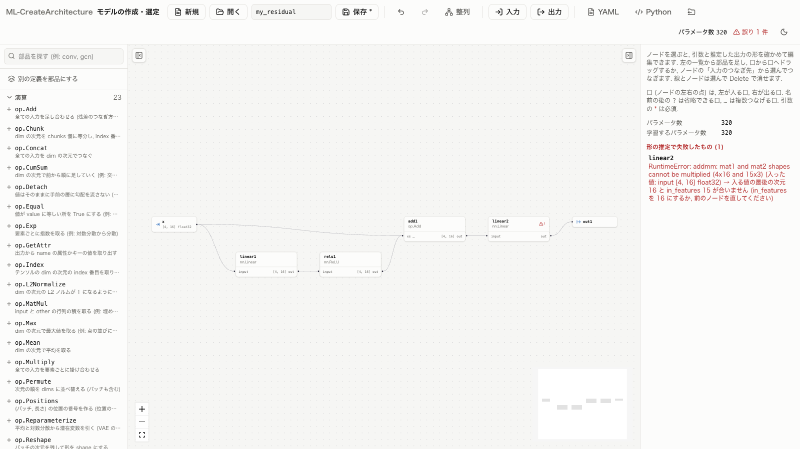</td>
  </tr>
  <tr>
    <td>ノードを選ぶと, 入ってきた値の形と直し方が出る</td>
    <td>何も選んでいないときは, 全体の誤りと注意の一覧が出る</td>
  </tr>
</table>

**見どころ**: 形の誤りの文は, 実際に入ってきた値 (`input [4, 16] float32`) と, どの引数をどう直せばよいかを添える. 誤りのあるノードより先のノードは形が分からないので, 形が出ない.

## 6. 例を開き, YAML と Python のコードを見る

「開く」には, 自分で保存した定義と, 同梱の例 (全結合, 残差, CNN, LSTM, Transformer のエンコーダー, GCN, BERT の分類 (Hugging Face の BERT と, 部品から組んだ小さな BERT), 部分モデルを重ねたもの) が並ぶ. 分類のほかに, 受け持ちごとの雛形 (VAE, GAN の生成器と識別器, 拡散モデルの雑音の予測器, 対照学習の符号化器, 推薦と検索の 2 塔, 強化学習の方策と価値) もある. 雛形の説明には, 学習の step で行うこと (損失の足し方など) も書いてある. 例は作り方の見本として開ける (開いたものを直して, 別の名前で保存してもよい).

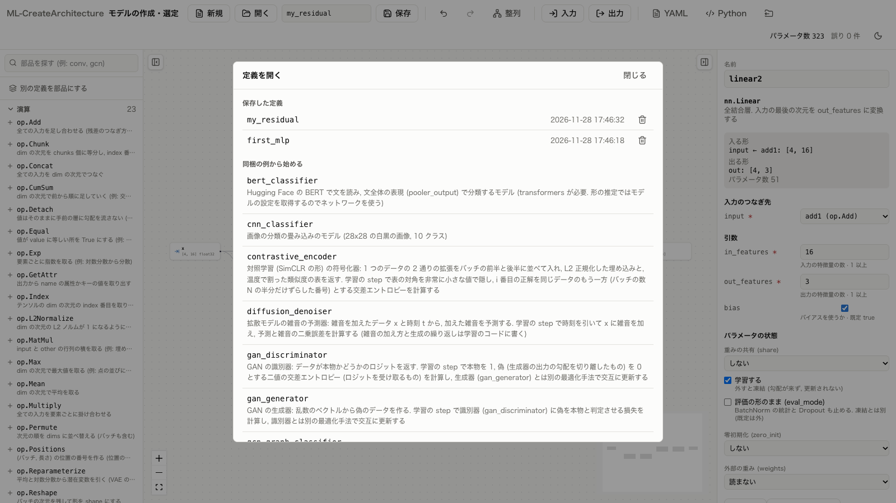

### やってみる 4: CNN を開き, 定義とコードを見る (5 分)

- [ ] 上の「開く」から `cnn_classifier` を開く (今の変更を保存していない場合は確かめられる)
- [ ] 画像 `[4, 1, 28, 28]` が, 畳み込み (`[4, 16, 28, 28]`), プーリング (`[4, 16, 14, 14]`), 2 つ目の畳み込み (`[4, 32, 14, 14]`), 全体の平均 (`[4, 32, 1, 1]`), 平らにする (`[4, 32]`), 全結合 (`[4, 10]`) と変わる流れを, ノードの形でたどる (小さくて読めない場合はホイールで拡大する). 上の「パラメータ数 5.1K」を見る
- [ ] 上の「YAML」を押し, 保存する形 (入力, ノード, 出力を書いた YAML) を見る. 「コピー」と「ダウンロード」ができる
- [ ] 上の「Python」を押し, 同じ計算をする `nn.Module` のクラスのコードを見る. このコードは ML-ModelControl を入れていない環境でも動く (外部のライブラリの部品を使う場合は, そのライブラリは要る)

<table>
  <tr>
    <td>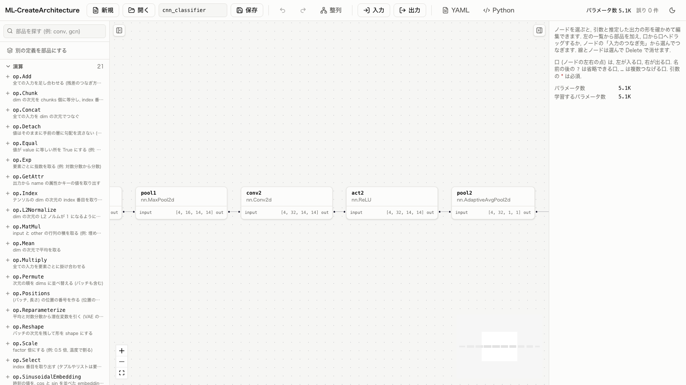</td>
    <td>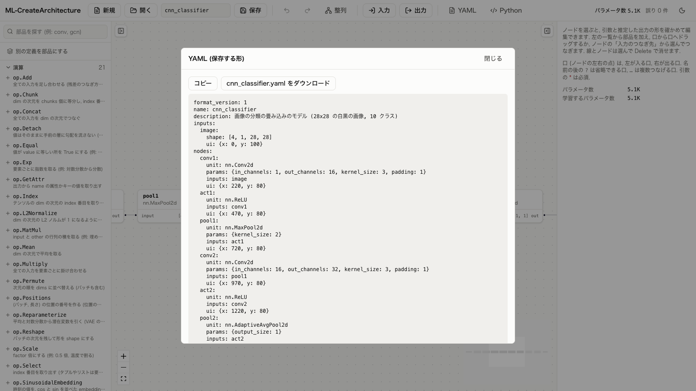</td>
    <td>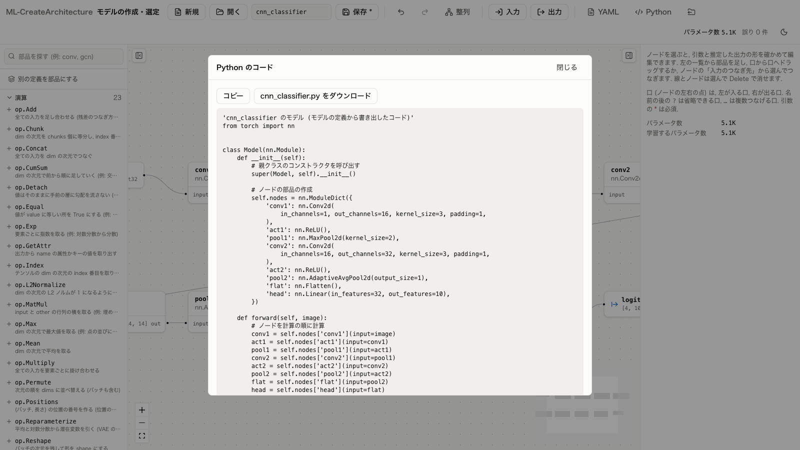</td>
  </tr>
  <tr>
    <td>CNN の例 (拡大した所). ノードごとに出力の形が出る</td>
    <td>保存する形 (YAML)</td>
    <td>同じ計算をする Python のコード</td>
  </tr>
</table>

**見どころ**: YAML の `ui` は画面の位置で, モデルの計算には使わない. Python のコードの `state_dict` のキーは, ML-ModelControl で組み立てたモデルと同じなので, どちらで学習した重みも読み込める.

## 7. 部分モデル (別の定義を部品にする)

保存した定義や例を, 今の定義の中で 1 つの部品 (`sub.<名前>`) として使える. 同じブロックを何回も重ねるモデルを作るときに使う.

- 定義の中に写すので, 元の定義を後で変えても, 写したものは変わらない (1 つのファイルだけで組み立てられる)
- 元の定義を直した後に揃えたい場合は, 一覧の部分モデルの写し直しのボタンを押す
- 同じ部分モデルを何回置いても, 重みは別々

### やってみる 5: 部分モデルを重ねた例を見る (3 分)

- [ ] 「開く」から `stacked_blocks` を開く. 左の一覧の一番上に「部分モデル」の `sub.res_block` があり, キャンバスでは `block1` から `block3` の 3 つのノードがそれを使っている
- [ ] `block1` を押し, 右の詳細の「部分モデルの中身」を開いて, 中のノードを見る
- [ ] `block1` をダブルクリックする (詳細の「部分モデルの中身を編集」でもよい). キャンバスが部分モデルの中身に変わり, 上に「本体 › sub.res_block を編集中 (変更は使っているノード 3 個すべてに反映)」と出る
- [ ] Esc を押して (上の「本体」を押してもよい) 本体に戻る

<table>
  <tr>
    <td>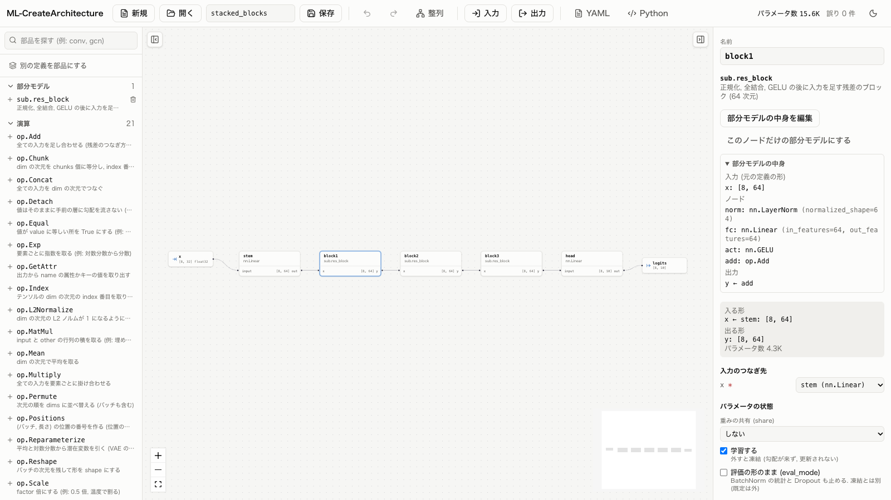</td>
    <td>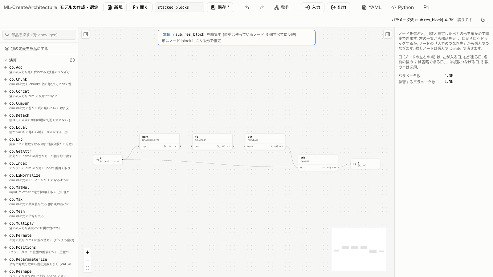</td>
  </tr>
  <tr>
    <td>部分モデルのノードの詳細 (「部分モデルの中身」を開いた所)</td>
    <td>部分モデルの中身を編集している間</td>
  </tr>
</table>

**見どころ**: 中身の形は, その部分モデルを使っているノードに入る形で推定される. 3 つのうち 1 つだけを変えたい場合は, 詳細の「このノードだけの部分モデルにする」で, そのノード用の別の部分モデルに写してから編集する.

### やってみる 6: 自分の定義を部品にする (3 分)

- [ ] 上の「新規」を押す
- [ ] 左の「別の定義を部品にする」を押し, 「保存した定義」の `first_mlp` を押す. 左の一覧の「部分モデル」に `sub.first_mlp` が加わる (説明は「入力 x → 出力 out1 (ノード 1 個)」)
- [ ] `x` を選び, `/` → `sub.first_mlp` → Enter で置く. `first_mlp` の入力 `x` が入る口, 出力 `out1` が出る口になっている
- [ ] 上の「出力」を押し, 「パラメータ数 68」(`first_mlp` と同じ) になることを見る

<table>
  <tr>
    <td>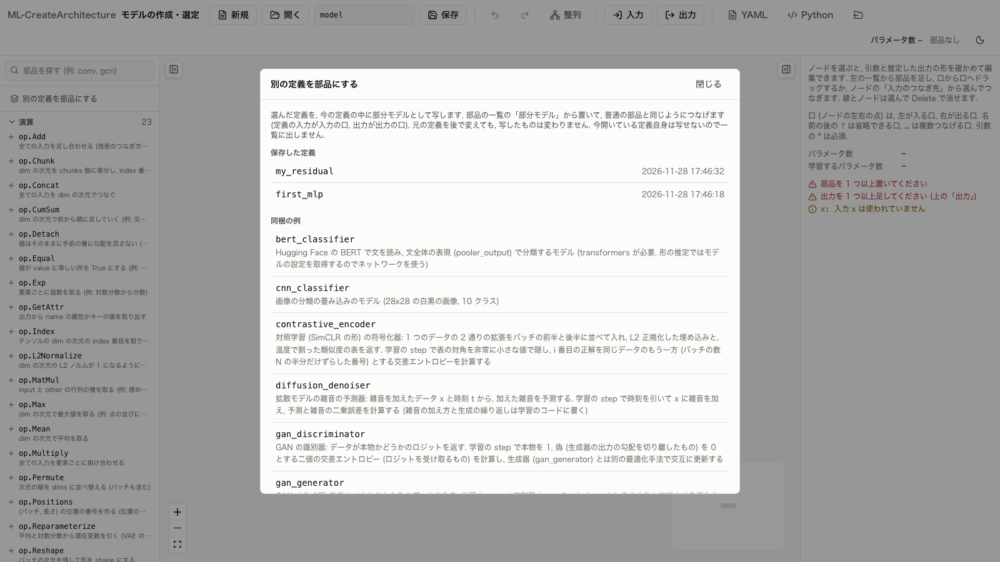</td>
    <td>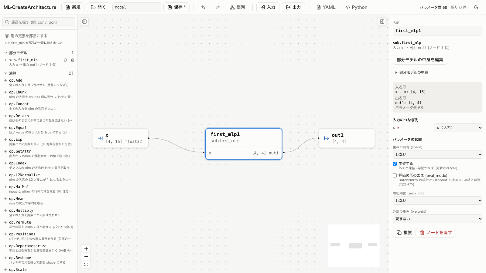</td>
  </tr>
  <tr>
    <td>保存した定義と例から選ぶ</td>
    <td>sub.first_mlp を部品として置いた</td>
  </tr>
</table>

## 8. 保存と下書き

- 保存した定義は, 上の「開く」の「保存した定義」に並ぶ. ごみ箱のボタンで消せる
- 開いたものと違う名前で, 既にある定義に保存しようとすると, 上書きしてよいかを確かめる
- 名前は英数字, `_`, `-` だけ
- 保存していない変更は, 少し待つとブラウザに下書きとして残る. 閉じたり読み込み直したりしても, 次に開いたときに「保存していない定義の下書きがあります」と出て, 「下書きを開く」で戻せる (14 日まで. 保存する名前の欄に打った名前も戻る)

### やってみる 7: 下書きから戻す (2 分)

- [ ] やってみる 6 の定義 (保存していない) のまま, 数秒待ってから (下書きは変更の 1 秒ほど後に残る) ブラウザで読み込み直す. ブラウザが「変更が保存されない可能性があります」と確かめてきたら, 「再読み込み」を選ぶ (下書きに残っているので大丈夫)
- [ ] 上に「保存していない定義 model (日時) の下書きがあります」と出ることを見る
- [ ] 「下書きを開く」を押し, `sub.first_mlp` を置いた定義に戻ることを見る. 要らなければ「下書きを捨てる」

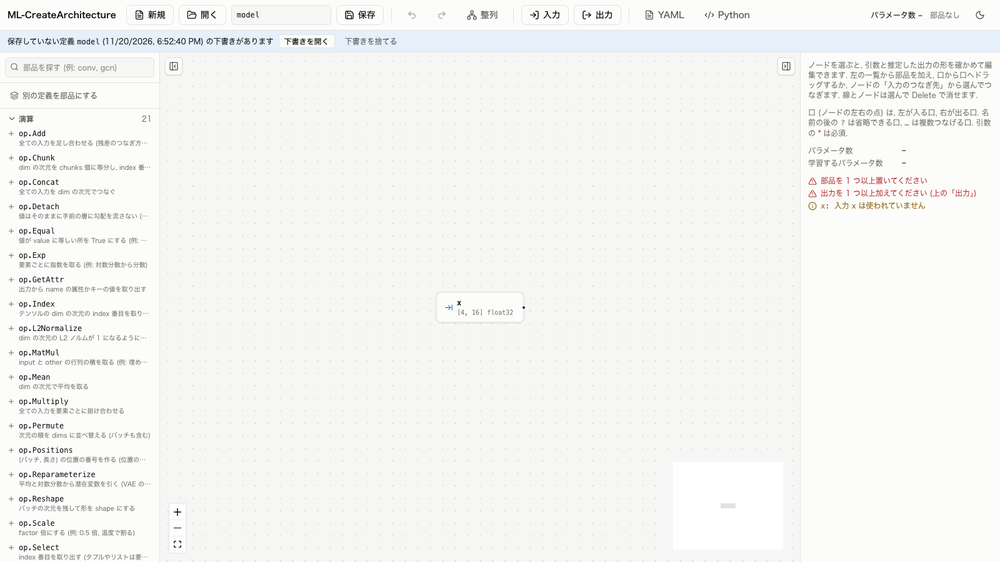

## 9. 作った定義を使う

保存した定義は `~/.ml-createarchitecture/models/<名前>.yaml` に置かれる (環境変数 `ML_CREATEARCHITECTURE_HOME` で変えられる). 上の「YAML」のダウンロードでも手に入る.

定義は [ML-ModelControl](https://github.com/victor-von-pooh/ML-ModelControl) で `nn.Module` にできる. ML-ModelControl はこのアプリのバックエンドに入っているので, 試すだけなら次のように使える.

```bash
cd backend
uv run python
```

```python
from pathlib import Path

import torch
from ml_modelcontrol import build_model

model = build_model(Path("~/.ml-createarchitecture/models/my_residual.yaml").expanduser())
print(model(torch.randn(4, 16)).shape)   # torch.Size([4, 3])
```

- 自分の環境 (学習のプロジェクトなど) では, `pip install "ml-modelcontrol @ git+https://github.com/victor-von-pooh/ML-ModelControl.git"` で入れる
- ML-Found で学習する手順は, [ML-ModelControl](https://github.com/victor-von-pooh/ML-ModelControl) の README にある
- ML-ModelControl も入れたくない場合は, 上の「Python」のコードをそのまま使う

### 学習のプロジェクトにつなぐ

ML-Pathfinder (ML-Quest) で書き出した学習のプロジェクトと, ML-Fathom (ML-EDA) で書き出したデータセットがある場合は, 上の「データセットとプロジェクト」(幅 1800 px 未満ではフォルダのアイコンだけ) で, 値を手で写さずにつなげる. `make setup` で入る ML-EDA と ML-Quest を使う (`EXTRAS` を書いて `project` を外した場合は, 入れ方が出る).

ML-Pathfinder でプロジェクトを書き出した問題の設定は, 一番上の「問題の設定から選ぶ」の一覧から選べる. 押すと, 下の「プロジェクトか問題の設定」に problem.yaml が入って保存先が出て, 「データセットのディレクトリ」に記録のデータセットの場所が入る (場所を打たずに 1 と 4 へ進める). プロジェクトを書き出していないものなどは, 理由を付けて選べなくなっている. 一覧は ML-Pathfinder の置き場 (環境変数 `ML_PATHFINDER_HOME`. 無ければ `~/.ml-pathfinder`) を読む.

1. 「データセットのディレクトリ」に, 書き出したデータセット (`dataset.yaml` を持つディレクトリ) の絶対のパスを書き, 「入力と出力を作る」を押す
    - 入力の名前, 形 (バッチの次元は例の大きさ 4), 型がデータセットに合う. データセットで決まらない次元 (大きさの混ざる画像の高さと幅など) は定義の値のまま. 入力に直につながる `nn.Linear` などの `in_features` と, `nn.Conv2d` などの `in_channels` (チャンネル), 文のデータセットなら `nn.Embedding` の `num_embeddings` (語彙の大きさ) も合わせる
    - 部品の無い定義なら, 全結合の `head` (出す値は分類はクラスの数, 回帰は 1, 予測は先の期の数か 1) を置いて出力 `out` につなぐ. 出力が 1 つで, その手前が `out_features` か `out_channels` を持つ部品なら, それを出す値の数にする. 手前が `op.Reshape` なら, その最初の次元と 1 つ前の `out_features` を合わせる. 合わせられない場合は, 手で入れる値が出る
    - ファイルの組のデータセット (ML-Fathom の「画像と領域」「撮影と点群」の書き出し) も読める. 同梱の例 `unet_segmentation` は最初の畳み込みの `in_channels` と `head` の `out_channels` (背景を含む領域のクラスの数) が, `point_cloud_predictor` は入力の点の数と出す点の数 (`decode2` の `out_features` と `cloud` の `shape`) が合う
    - 何を変えたかは欄の下と部品の一覧の上に出る. 元に戻すで戻せる (部分モデルの中を編集している間は, 本体に戻ってから)
2. 組み立てを続ける
3. 「プロジェクトか問題の設定」に, プロジェクトのディレクトリか問題の設定のファイル (`problem.yaml` など) の絶対のパスを書き, 「保存先を確かめる」を押す
    - 保存先は, 問題の設定に骨組みを書き出したときの記録があればその場所, 無ければプロジェクトの `models/model.yaml` (学習のスクリプトが config の `model.spec` から読む場所)
    - 保存先が `configs/` の中 (学習の設定) を指す場合は書かない. 保存先までの無いディレクトリは, プロジェクトの中だけ作る
    - データセットの欄に, 学習のスクリプトが読むデータセットの場所 (記録の場所. 記録が無ければ config の `data.dataset`) が入る (まだ打っていない場合)
4. 「この場所に保存」を押す. 既にファイルがある場合は, 上書きしてよいかを確かめる. 保存すると「<保存先> に保存しました」と出る

- 書いたプロジェクトとデータセットの場所はブラウザが覚えていて, 次に開いたときに欄に入る
- プロジェクトに保存しても, アプリの置き場の定義 (上の「保存」) は変わらない. 続けて手を入れる場合は, 置き場にも保存しておく
- プロジェクトに保存した定義は, 学習を始めるときに ML-Found が実験の出力先に `model_spec.yaml` として写す. 後で定義を直しても, 前の実験がどの定義で学習したかは実験の出力先に残る

## 10. 自作の部品を使う

研究で書いた自作の部品 (`nn.Module` のクラス) は, 部品を宣言したモジュールの名前を環境変数 `ML_CREATEARCHITECTURE_MODULES` (カンマで区切って複数) に書いて起動すると, 部品の一覧の「自作 (モジュールの名前)」に出る. モジュールはバックエンドの Python から import できる場所 (`PYTHONPATH` か, バックエンドの環境に入れたパッケージ) に置く.

```python
# my_lab/units.py
import torch
from torch import nn


class Scale(nn.Module):
    """入力を決めた倍にする部品"""

    def __init__(self, factor: float = 2.0):
        super().__init__()
        self.factor = factor

    def forward(self, x: torch.Tensor) -> torch.Tensor:
        return x * self.factor


# 部品の宣言 (クラスか, ML-ModelControl の register_unit の引数の辞書)
UNITS = [{"cls": Scale, "name": "lab.Scale"}]
```

```bash
ML_CREATEARCHITECTURE_MODULES=my_lab.units PYTHONPATH=<my_lab を置いたディレクトリの絶対パス> make serve
```

起動のログに `自作の部品を読み込みました: my_lab.units → lab.Scale` と出る. 読み込めないモジュールがあると, 理由を出して起動しない. `make serve` はバックエンドのディレクトリで起動するので, `PYTHONPATH` は絶対パスで書く. 開発用のサーバー (`make dev-backend`) でも同じ環境変数で読み込むが, 自作の部品のファイルを直しても作り直されないので起動し直す. 宣言の書き方 (`UNITS` のほかに `register_units(register)` の関数も書ける) は ML-ModelControl の docs/DESIGN.md の「自作の部品のモジュール」を参照.

- **書いたモジュールは, 起動のときに任意のコードとして動く**. 自分や仲間が書いた, 信頼できるコードだけを書く
- 読み込むのは, この環境変数に書いたモジュールだけ. 定義のファイルに書かれた部品の名前や, 画面と API からは何も読み込まない. 登録されていない部品を使う定義を開くと, 登録されていないという誤りと, 起動の設定 (環境変数の名前) に足す案内と, 今読み込んでいるモジュールが出る

## 11. 操作の一覧

キーの Ctrl は, Mac では Cmd.

| 操作 | 方法 |
| --- | --- |
| 部品を探す | `/` で左の検索欄に移る. Enter で, 名前が合う使える部品を置く |
| 部品を置く | 一覧の部品を押す (見えている範囲に置く) か, キャンバスにドラッグする (落とした位置に置く. 線は引かない) |
| つないで置く | 入力かノードを選んだまま部品を置くと, つなぎ方が 1 通りに決まる場合はそこから線を引く |
| 線を引く | 出る口から入る口へドラッグ, または詳細の「入力のつなぎ先」で選ぶ |
| 消す | 線かノードを選んで Delete か Backspace (詳細の「ノードを消す」でもよい) |
| 元に戻す・やり直す | Ctrl+Z, Ctrl+Shift+Z (か Ctrl+Y) |
| 複製 | 詳細の「複製」か Ctrl+D. Ctrl+C と Ctrl+V でも写せる (つなぎ先は写さない) |
| 並べ直す | 上の「整列」 |
| 入力と出力を加える | 上の「入力」と「出力」. 入力は詳細で形 (バッチの次元も含む) と型 (単語の番号や `edge_index` は `int64`) を決める |
| 保存 | 上の「保存」か Ctrl+S |
| データセットから入力と出力を作る, プロジェクトに保存 | 上の「データセットとプロジェクト」(9 章) |
| 別の定義を部品にする | 左の「別の定義を部品にする」で保存した定義か例を選ぶ. 一覧の「部分モデル」に `sub.<名前>` として出る |
| 部分モデルを写し直す | 元の定義を直した後に, 一覧の部分モデルの写し直しのボタン. 元の定義の今の中身に置き換わる |
| 部分モデルを消す | 一覧の部分モデルのごみ箱 (使っているノードが無いものだけ) |
| 部分モデルの中身を編集 | 部分モデルのノードをダブルクリック. Esc で 1 つ上に戻る |
| 部分モデルを 1 つのノードだけ変える | 詳細の「このノードだけの部分モデルにする」(2 つ以上のノードが使う部分モデルの場合に出る) |
| torchvision と timm のモデルの名前 | 詳細の引数 `name` (timm は `model_name`) の欄に打つと候補が出る |
| 選んだノードに戻る | 詳細の欄の中で Esc |

## 12. 困ったとき

| 症状 | 対処 |
| --- | --- |
| 画面を開いても読み込めない | トークン付きの URL (`/api/auth?token=…`) を開き直す. 起動し直すとトークンが変わる |
| ポート 8766 が使われている | `make serve PORT=8800` のように別のポートで起動する |
| 部品が「使えない」と出て置けない (検索の Enter でも置かれない) | その部品のライブラリが入っていない. 理由に出る `make setup EXTRAS="project …"` で入れて, 起動し直す (例: `make setup EXTRAS="project torchvision"`. 全て入れると数 GB) |
| ノードに形が出ない | そのノードか前のノードに誤りがある (5 章). 入力の形が書かれていない場合も推定しない |
| 上に「形は未推定」と出る | モデルが大きすぎて形の推定を止めた. 確認 (引数とつなぎ方) はされている |
| Hugging Face のモデルの形が出ない | 設定の取得にネットワークを使う. 手元に無いモデルは, ネットワークのある環境で一度推定する |
| 保存した定義を消したい | 「開く」の一覧のごみ箱のボタン |
| 「ml_eda が入っていません」(か ml_quest) と出る | `make setup` で入れて起動し直す. `EXTRAS` を書く場合は `project` も含める (例: `make setup EXTRAS="project torchvision"`) |
| 「dataset.yaml がありません」と出る | 書き出したデータセットのディレクトリ (プロジェクトの `outputs/dataset` など) を選ぶ. 元のデータのファイルやプロジェクトのディレクトリではない |
| 「学習の設定のディレクトリ (configs/) の中です」と出る | config の `model.spec` が `configs/` の中を指している. `models/model.yaml` などに書き直す |
| 「問題の設定から選ぶ」に出ない, 選べない | 一覧は ML-Pathfinder の置き場 (`ML_PATHFINDER_HOME`) の問題の設定だけ. 選べないものは理由を読み, ML-Pathfinder でプロジェクトを書き出す. 置き場の外のものは, 下の欄に場所を書く |
| 「プロジェクトを書き出していません」と出る | その問題の設定からはまだ骨組みを書き出していない. ML-Pathfinder でプロジェクトを書き出すか, プロジェクトのディレクトリを選ぶ. 書き出した後なら ML-Quest が古いので, `make setup` で入れ直す |
| 「書き出してありますが, モデルの定義の置き場の記録 (model.project_model_spec) がありません」と出る | 骨組みの config にモデルの定義の場所 (`model.spec`) が無いプロジェクト. プロジェクトのディレクトリを選ぶと, config の `model.spec` (無ければ `models/model.yaml`) に保存する |
| アプリを止めたい | `make serve` を動かしている端末で Ctrl+C |
